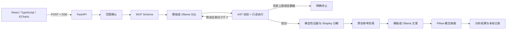

# 架构与改进记录

## 数据流

LangGraph 通过标准 MCP ClientSession 和 stdio transport 访问两个独立子进程，不直接把被装饰的工具函数 import 到 Agent 里。业务服务与协议适配分离，单元测试能独立验证安全与指标逻辑。每次运行独立 MCP 会话，避免并发请求共享可变工作状态。

步骤追踪器只展示节点名称、状态、耗时与重试次数，不展示或伪造模型隐藏思维链。浏览器演示使用另一组真实本地计算阶段，不伪造 MCP 执行记录。

## 对 Gemini 方案的改进

1. **可运行性优先**：默认 SQLite 无外部依赖；MySQL Compose 保留；Ollama 可配置，不假设某块 GPU 或 LAN 地址存在。
2. **协议真实**：装饰 FastMCP 工具后直接调用普通 Python 函数不能证明使用了 MCP。此实现确实经过初始化、协议序列化与子进程 transport。
3. **SQL 分层边界**：单条 SELECT AST、真实物理表与列校验、函数白名单、禁止危险结构与跨库引用、限制复杂度、自动 LIMIT / 拒绝过大 LIMIT、数据库只读账号与事务、执行超时。LIMIT 限制返回量，不能阻止昂贵扫描，因此另加时间边界。没有“100% 安全”承诺。
4. **有界故障处理**：生成错误与查询错误进入最多三次总尝试。到达上限明确失败；空数据不编造诊断；模型错误不会悄悄变成“AI 成功”。
5. **指标正确**：加权比率、ROAS 与 ROI 区分、零分母空值、等长窗口且完整覆盖。产品与平台规范化，避免一个 SKU 只能存在一个平台。
6. **归因约束**：定量变化与精确 ROAS 分摊由代码计算。假设与因果结论分开，没有把“CTR 下滑与留存下滑”直接写成已证实原因。
7. **不捏造资源**：没有假定已有 nomic 索引。默认原创词法检索，可选真实 Ollama embedding + FAISS。所有参考带来源，无“爆款”效果保证。
8. **创意标识**：文案标注模板或模型来源；Pillow 图注明概念插画，避免误作商品实拍；不凭空生成折扣或效果保证。
9. **运行可观察**：SSE、保活、停止按钮、断线取消、明确终态、最近运行记录、最大 3 个并发运行、每个请求自己的状态。
10. **工程可交付**：锁定依赖、测试、同源生产服务、一键启动、Docker、随机密码、配置样例、演示脚本。

## 当前边界

这是个人作品集的完整演示项目，不是已经投入多商家生产的 SaaS。真实商用仍需要身份与租户隔离、受控数据接入、货币与归因规则、数据质量 SLA、审计留存与清理、任务队列、成本控制和负载验证。没有接入真实 TikTok / Amazon / Shopify 商家 API。

Run 历史是单机独立 SQLite 数据库，BI 数据库只读；应用进程仍需要写分析记录与生成海报。没有把写权限偷偷放进 BI 只读 MCP。

原计划的“5–7 天达到工业级”和“100% 拦截注入”过于绝对。交付能运行、验证并解释清楚的闭环，比缺乏验证的生产级标签更适合技术面试。

## 可替换组件

- `services/llm.py`：模型客户端当前实现 Ollama；可以另加兼容提供商，不需要修改 SQL 策略。
- `services/database.py`：SQLite 与 MySQL 的只读执行适配。
- `services/creative.py`：参考检索、文案模板与海报排版；可对接有授权的商品素材。
- `agent/graph.py`：状态节点与条件边，定量报告与创意节点保持独立。

SQL 使用严格分析子集。有些安全 SQL（如 UNION、复杂日期函数、自定义函数）也会被拒绝，这是明确的支持范围，不能通过绕过策略来解决。
